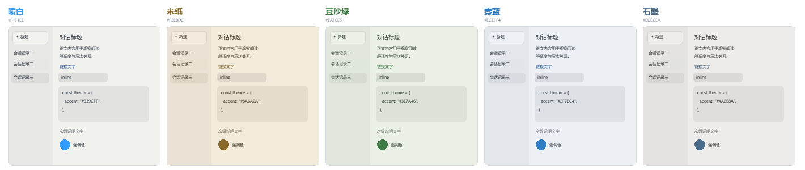
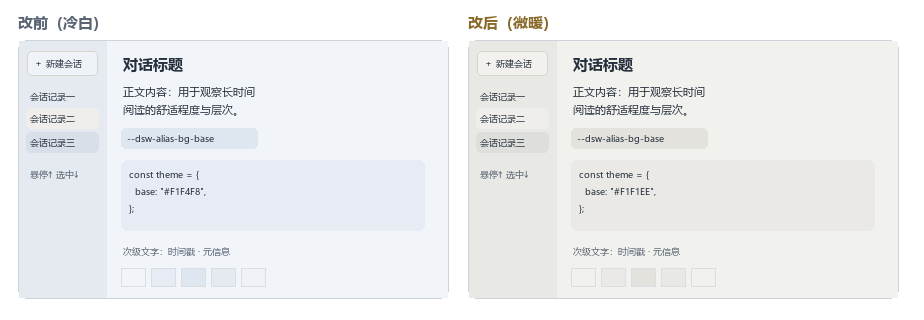
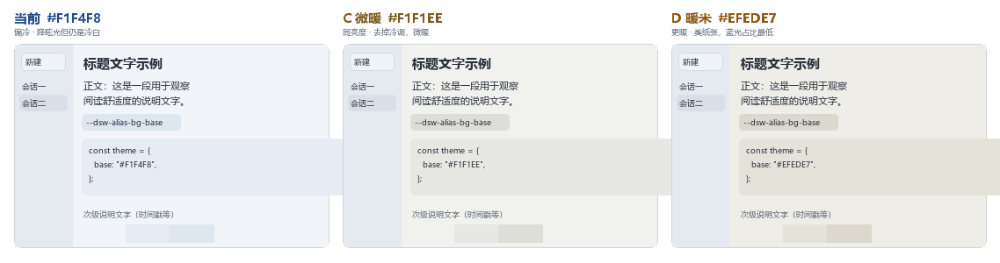
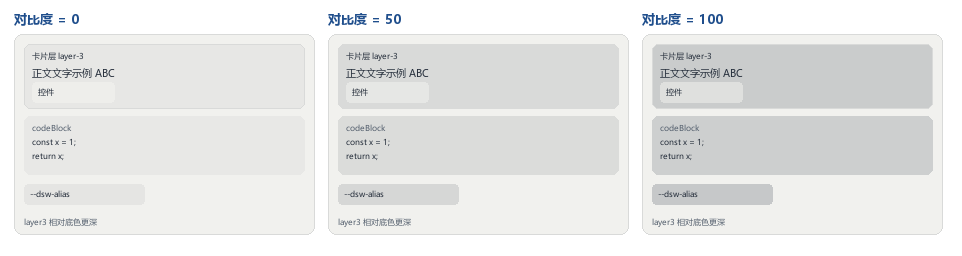

# DeepSeek Harness 护眼外观插件

在设置中增加「外观」页，提供五套护眼主题（暖白、米纸、豆沙绿、雾蓝、石墨），以及跟随系统/浅色/深色模式、强调色与背景色、界面与代码的字体和字号、字体样式、内容宽度、对比度、纸张质感和减少动态效果等设置。每套主题各自带有匹配的强调色与链接色，并覆盖消息气泡、轮次预览、输入框、改动文件卡片等界面区域；深色模式保持蓝灰。字体下拉会列出本机安装的全部字族（由插件主进程读取系统字体清单，读不到时回退到内置候选探测），可分别设置界面、内容与代码字体。纸张质感在内容区、侧栏、输入框和卡片上叠一层极淡的纸纤维颗粒，强度可调；纹理自带主题底色，不改变原有色温，也不触碰原生标题栏。输入框在鼠标移入时轻微上浮、聚焦输入时落回原位。通过 Harness 的主题 token 和设置 section 扩展点工作；设置保存在当前桌面应用的本地浏览器存储中。

Eye-comfort appearance controls for DeepSeek Harness: five light themes, accent and background colours, typography, content width, contrast and motion. This is an independent community plugin, not an official Codex or DeepSeek product.

已在 Windows 上 DeepSeek Harness 0.2.0-rc.2 中验证安装、设置界面与浅色/深色主题效果。字体清单通过主进程调用系统接口读取（Windows 用 GDI+，macOS 用 system_profiler，Linux 用 fc-list），不修改系统设置。

## 截图









## 安装

从 [Releases](https://github.com/AaronKate/dsh-codex-appearance/releases) 下载 `dsh-eye-comfort-0.3.16.tgz`，执行：

```sh
dsh plugin --profile desktop add ./dsh-eye-comfort-0.3.16.tgz
```

本地开发可在仓库根目录 `npm pack` 后从 `dist/` 安装打包产物。

重启 DeepSeek Harness，在「设置 → 外观」中调整。Windows 上 PowerShell 同样使用以上命令；路径可改为下载文件的绝对路径。要求 DeepSeek Harness 版本包含 `ui-theme` 和 `settings.section` 插件接口。

> 从 `dsh-codex-appearance` 改名为 `dsh-eye-comfort`。若你装过旧版本，请先执行下方卸载命令移除旧包，再按上面的方式安装新包；外观设置保存在浏览器存储中，与包名无关，重装后不会丢失。

## 卸载

```sh
dsh plugin --profile desktop remove dsh-eye-comfort
```

此插件不修改应用安装包或签名。与其他主题插件同时启用时，最后注册的 token 覆盖层决定同名颜色。当前版本的设置属于本机当前桌面应用，不跨设备同步。
